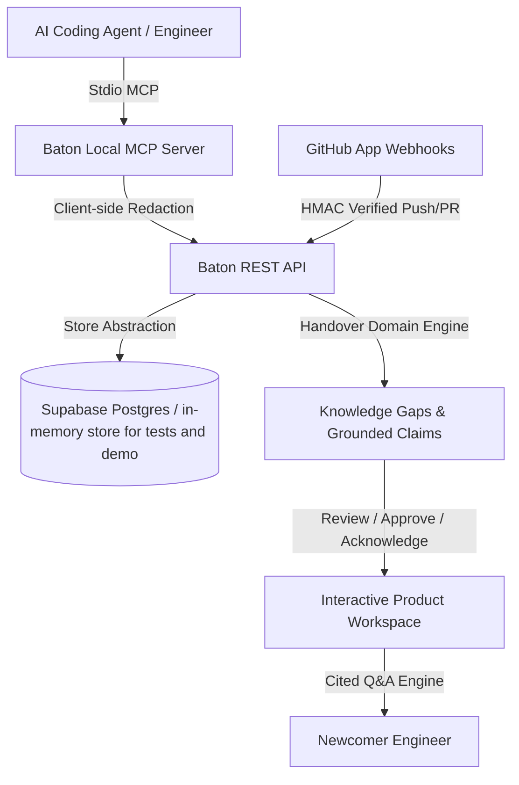

# Baton System Architecture

Baton is an autonomous developer continuity and handover platform that indexes architectural decisions, operational blockers, and git context in real-time.

---

## 🏛️ Core Architectural Pillars

### 1. Dual-Mode Store Abstraction (`server/store.js`)
- **Production Mode**: Backed by Supabase PostgreSQL. The API uses the service-role key and enforces organization isolation, membership checks and visibility tiers (`team`, `admin`, `private`) itself; the schema also enables RLS for direct client access.
- **Demo**: `/demo-page` keeps its state in the browser and answers every call with the real engine through `POST /api/demo` (`server/demo.js`) and a bundled synthetic snapshot; it needs no credentials and never touches production data. `BATON_DEMO_MODE=true` swaps Supabase for a seeded in-memory store and exists for tests and offline use only.

### 2. Client-Side Secret Redaction (`server/redact.js` & `mcp-server/src/redact.ts`)
- Pattern- and entropy-based redaction of tokens, JWTs, private keys, database URLs and environment variables before data leaves the MCP client and again before the server stores it. It reduces, but cannot eliminate, the chance of a secret being stored.
- Shannon entropy threshold (>= 4.5) catches random credentials and API keys.

### 3. Grounded Handover Domain Engine (`server/handover.js`)
- **Gap Detection**: Identifies decisions lacking rationale or affected files, active blockers without workarounds, and unmerged ahead branches.
- **Exit Interview Generation**: Synthesizes targeted questions for departing engineers to capture uncommitted context.
- **Evidence-Based Claims**: Produces categorized claims with confidence ratings. Citations are validated against the supplied sources (unknown ids are dropped) and a claim is `verified` only when its text appears verbatim in a cited source; otherwise it is `inferred`. If Gemini is unavailable or returns invalid output, a deterministic evidence-only compiler is used and the result is labelled `evidence-only`.
- **Cited Q&A**: Answers newcomer queries strictly grounded in approved handover evidence with direct citations.

### 4. Local Model Context Protocol (`mcp-server/`)
- Integrates with modern AI agent harnesses (Antigravity, Cursor, Claude Desktop).
- Implements ten tools: `log_decision`, `log_blocker`, `get_context`, `bootstrap_project`, `save_memory`, `get_file_context`, `sync_history`, `github_activity`, `get_exit_interview`, `answer_exit_question`.
- Tracks incremental file snapshots with SHA-256 caching.

### 5. Product Frontend (`src/components/Workspace.jsx`)
- Workspace tabs: Overview (risk metrics), Memory & Decisions, GitHub (connect, sync, disconnect), Team & Tokens, Tasks, Handovers (lifecycle, cited Q&A, Markdown export), plus workspace settings (rename, reset, delete).

## Workspace management and export

Admin-only routes (never available to API tokens): `PATCH /api/orgs/:id` renames, `DELETE /api/orgs/:id` removes the organization and everything in it, `POST /api/orgs/:id/reset` removes memory (`scope: "sources"`) or memory plus tasks and handovers (`scope: "all"`), and `DELETE /api/orgs/:id/repositories/:repoId` disconnects a repository and the sources synced from it. Destructive organization routes require `confirm` to equal the exact organization name. Deletes are explicit per table, not database cascades; members, tokens, invites and the GitHub link survive a reset. `GET /api/handovers/:id/export.md` returns an approved handover as a Markdown attachment (claims by section with cited sources, resolved conflicts, known gaps; participants by GitHub login, never email) using the same visibility and audience filtering as the detail route.

Search (`GET /api/collector/search`) re-checks every hit, vector or text, against source visibility and the caller's audience, because the database function `match_memory` does not filter by visibility.

## Round 3 handover intelligence

### Risk score (`server/risk.js`)
Each gap/exit-interview question is scored by the pure `scoreGap`; the score, `risk_reasons` (short strings) and a derived `risk_label` come back with every question, sorted by score descending, then creation time.

| Signal | Points |
| --- | --- |
| Bus factor 1 on a related module (sole contributor, ≥3 changes) | +40 |
| Unmerged branch ahead of its base | +30 |
| Outgoing member's open pull request | +20 |
| Unresolved blocker | +20 |
| Cited sources untouched for >30 days | +10 |
| Conflict involving the item | +15 |

The total is capped at 100; `high` ≥ 60, `medium` ≥ 30, else `low`. The legacy `risk` field never drops below the evidence severity the question was created with, so use `risk_label` for the score badge. Skipping a question (leaver or admin) sets status `skipped`, marks linked claims `missing` with a note and adds an "Unanswered gap" claim; answering stores a redacted `interview` source, links it to the claims and marks them verified.

### Conflict detection (`server/conflicts.js`)
`detectConflicts({ tasks, comments, memories, sources })` is deterministic and needs no model key. It reads dates (`2026-11-15`, `15 Nov`, `Nov 15`, unambiguous `15/11`; relative dates are ignored) that sit next to deadline wording in a task's comments or in memories/sources that mention the task, and compares them with the task's due date. Generation adds one `conflicting` claim per conflict citing both sources (the task and its comment become `task_comment` sources) and never picks a winner. An admin resolves it with a recorded `interview` source; the claim becomes `verified` and `approved`. An unresolved conflict claim cannot be approved.

### Modules and bus factor
A change's module is the first two directory segments of the path (`server/handover.js` → `server`, `src/components/X.jsx` → `src/components`, root files → `(root)`). Commit and pull-request file changes are counted per module and per contributor (GitHub logins are mapped to members; bots are ignored). `risks` returns `modules` (shares, last touched, minimum contributors covering ≥50%), a contributor × module `matrix` and `alerts` for modules with ≥3 changes and a single contributor.

### Audiences
Members may carry a function role (`backend`, `frontend`, `infra`, `data`, `design`, `product`; admin sets it). Sources carry `metadata.audience` (`["all"]` or roles), set explicitly at ingest or inferred from touched paths; claims and questions inherit the restriction from the sources they cite (hidden if any cited source is hidden). Viewers with a function role are filtered server-side in the handover detail, `ask` (before the model prompt is built), risks and the org state, and `hidden_count` reports what was withheld. Admins and members without a function role see everything.

### Version history
Every change saves a version whose snapshot includes claim ids and a `reason`. `GET /api/handovers/:id/versions/diff?from=&to=` compares two snapshots by claim id into `added`, `removed` and `changed`.

### Persistence and the Round 3 migration
`supabase/migrations/20261114_round3.sql` adds `handover_questions.risk_score` and `risk_reasons` and `org_memberships.function_role`. Production keeps working without it: conflicts, audiences and notes live in existing jsonb columns, the Supabase adapter drops the new columns when the database reports them missing, and missing scores are recomputed on read. Only saving a member's function role needs the migration (the API answers 503 until it is applied). Source types are validated against the canonical list in `server/sourceTypes.js`.
