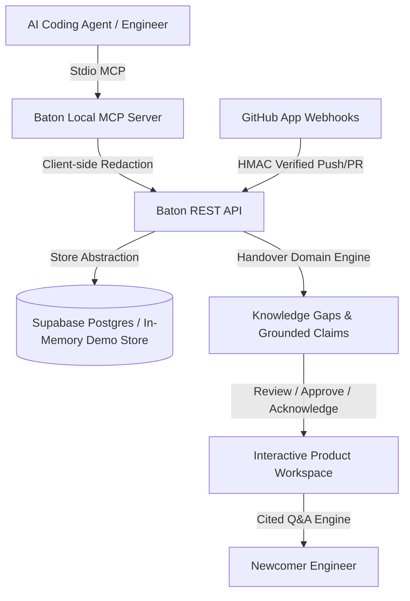

# Baton System Architecture

Baton is an autonomous developer continuity and handover platform that indexes architectural decisions, operational blockers, and git context in real-time.

---

## 🏛️ Core Architectural Pillars

### 1. Dual-Mode Store Abstraction (`server/store.js`)
- **Production Mode**: Backed by Supabase PostgreSQL with Row-Level Security (RLS). Enforces organization isolation, membership checks, and visibility tiers (`team`, `admin`, `private`).
- **Demo Mode**: Fully self-contained in-memory store preseeded with synthetic developer history (`server/demo.js`). Allows instant local and hackathon evaluation without external cloud dependencies.

### 2. Client-Side Secret Redaction (`server/redact.js` & `mcp-server/src/redact.ts`)
- Redacts high-entropy tokens, JWTs, private keys, database URLs, and environment variables before transmission to any network endpoint or storage layer.
- Shannon entropy threshold (>= 4.5) catches random credentials and API keys.

### 3. Grounded Handover Domain Engine (`server/handover.js`)
- **Gap Detection**: Identifies decisions lacking rationale or affected files, active blockers without workarounds, and unmerged ahead branches.
- **Exit Interview Generation**: Synthesizes targeted questions for departing engineers to capture uncommitted context.
- **Evidence-Based Claims**: Produces categorized claims with confidence ratings (`verified` with exact verbatim source evidence vs. `inferred`).
- **Cited Q&A**: Answers newcomer queries strictly grounded in approved handover evidence with direct citations.

### 4. Local Model Context Protocol (`mcp-server/`)
- Integrates with modern AI agent harnesses (Antigravity, Cursor, Claude Desktop).
- Implements tools: `log_decision`, `log_blocker`, `get_context`, `save_memory`, `bootstrap_project`, `get_github_activity`, `get_exit_interviews`, `answer_exit_question`.
- Tracks incremental file snapshots with SHA-256 caching.

### 5. Product Frontend (`src/components/Workspace.jsx`)
- 6 Interactive Tabs: Overview (continuous risk metrics), Memory & Decisions (searchable context feed), GitHub Integration (repo sync), Team & Tokens (RBAC & MCP tokens), Tasks (threaded discussions), Handovers (complete lifecycle & cited Q&A).
